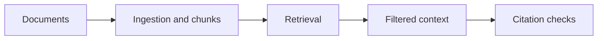

# ragOps

**Retrieve better. Ground every answer.**

Offline retrieval-augmented generation engineering toolkit for inspecting retrieval, context and citations.

  [](https://github.com/ops-universe/ragOps/actions/workflows/ci.yml)

> Development source repository. Public release is deferred. See [implementation status](docs/status/IMPLEMENTATION-STATUS.md) for scoped evidence and limitations.

## Why ragOps?

Inspect the retrieval pipeline and compare reproducible experiments without requiring a hosted model or vector database.

## Features

- Local document ingestion, chunking and lexical retrieval.
- Offline semantic/hybrid experiments with deterministic hash embeddings.
- Access-filtered context and corpus-relative citation verification.
- Synthetic experiments, enterprise scenarios and local dashboard.

## Architecture



[Architecture](docs/architecture/overview.md) · [Semantic retrieval and context](docs/architecture/semantic-context.md)

## Quickstart

Requires Node.js 22+ and npm. Work from the repository root; the package is private and not presented as an npm release.

```sh
git clone https://github.com/ops-universe/ragOps.git
cd ragOps
npm ci
npm test
npm run demo
```

## CLI and examples

Use synthetic fixtures only.

```sh
node src/cli.mjs fixtures/knowledge vacation hr.md catalog.txt
node src/benchmark.mjs
# Optional local dashboard (stop with Ctrl+C)
node src/serve-dashboard.mjs
```

## Configuration

CLI syntax: `node src/cli.mjs ROOT QUERY FILE [FILE...]`. Use trusted roots; the dashboard listens at http://127.0.0.1:4178. Role switching is simulated filtering, not authentication. No provider keys are required for offline examples.

## Scope and limitations

Trusted corpus, root and index paths; no race-free filesystem isolation. Hash embeddings are a lexical proxy; citation integrity is not factual correctness. No live provider compatibility or production authorization.

Read the [threat model](docs/security/threat-model.md) before integrating with real data or systems.

## Roadmap

See [ROADMAP.md](ROADMAP.md) and [implementation status](docs/status/IMPLEMENTATION-STATUS.md). Developer Preview launch and public release remain deferred.

## Contributing and support

Read [CONTRIBUTING.md](CONTRIBUTING.md), [Code of Conduct](CODE_OF_CONDUCT.md), and [SECURITY.md](SECURITY.md). Open a focused [issue](https://github.com/ops-universe/ragOps/issues) with a minimal synthetic reproduction or documentation proposal. Run `npm ci` and `npm test` before opening a focused PR. Report security concerns using the security policy rather than public issues.

## Related projects

[evalOps](https://github.com/ops-universe/evalOps) · [guardOps](https://github.com/ops-universe/guardOps) · [traceOps](https://github.com/ops-universe/traceOps) · [mcpOps](https://github.com/ops-universe/mcpOps) · [workflowOps](https://github.com/ops-universe/workflowOps) · [dataOps](https://github.com/ops-universe/dataOps) · [Ops Universe](https://github.com/ops-universe)

## License

[MIT](LICENSE)
